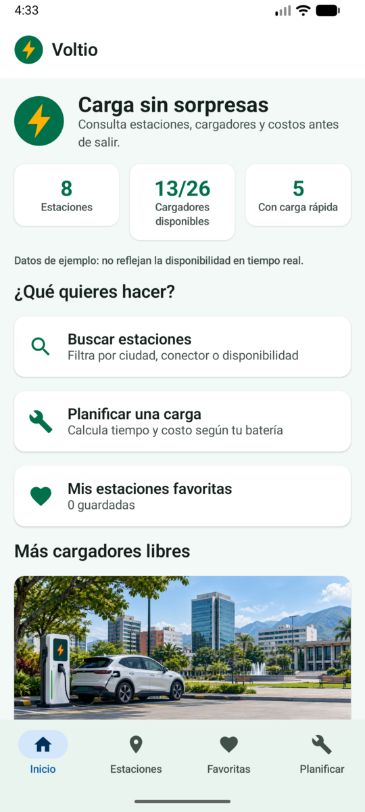
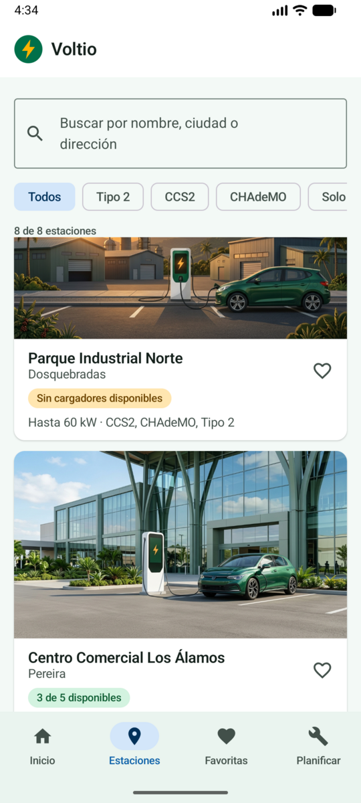
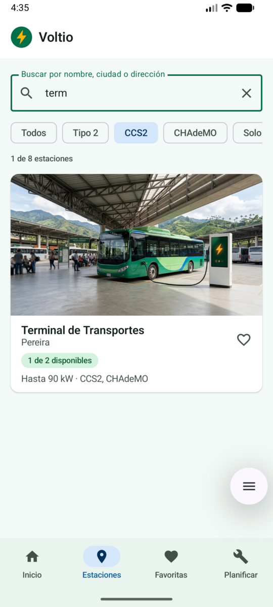
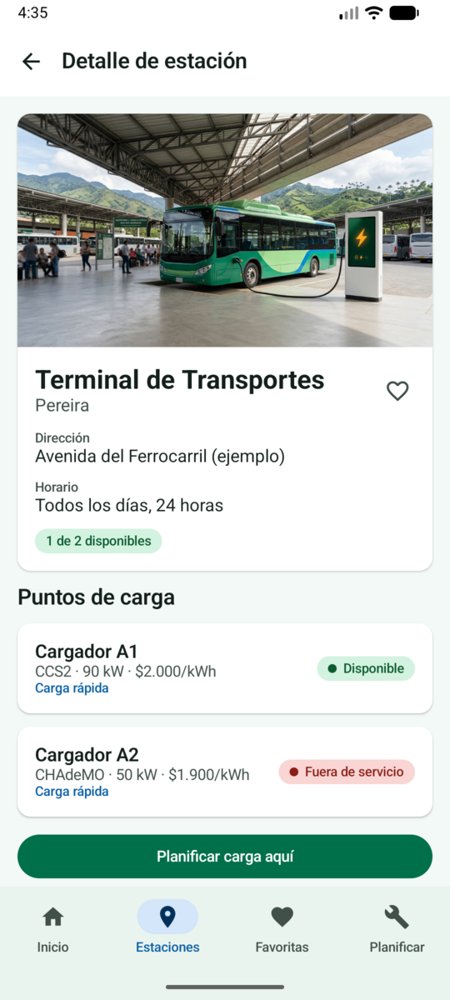
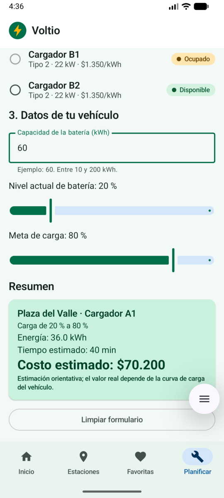
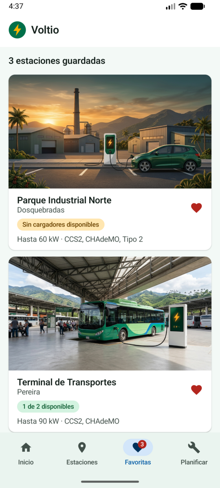
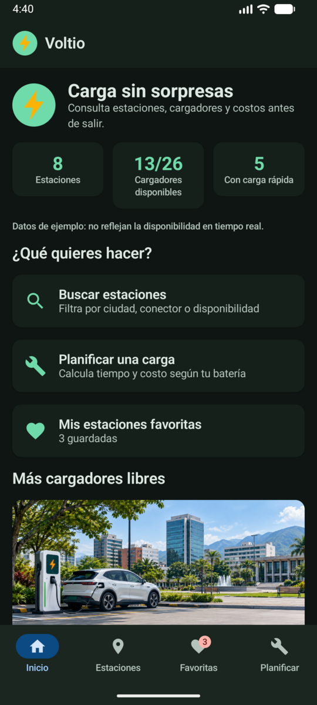

# Voltio

*Carga sin sorpresas.* Aplicación móvil Android (Kotlin + Jetpack Compose) para **consultar estaciones de carga de vehículos eléctricos**, ver el estado de cada cargador y **planificar una carga** (tiempo y costo en COP).

Proyecto del curso *Aplicativos Móviles* — «Proyecto: introducción a Jetpack Compose».
Estudiante: Harrison Quitumbo Sanchez · Universidad Tecnológica de Pereira.

## Negocio y objetivo

**Negocio:** una red de estaciones de carga para vehículos eléctricos.
**Objetivo:** que el conductor decida *antes de salir* a qué estación ir: dónde hay cargadores libres, qué conector y potencia ofrece cada uno, cuánto costaría cargar y cuánto tardaría.

> Los datos son **de ejemplo** (8 estaciones y 26 cargadores ficticios definidos en el código). No son información en tiempo real.

## Pantallas (Navigation Compose, 5 destinos)

| Pantalla | Qué hace |
|---|---|
| **Inicio** | Identidad de la app, resumen calculado (estaciones, cargadores disponibles, estaciones con carga rápida), accesos rápidos y las 3 estaciones con más cargadores libres. |
| **Estaciones** | Listado adaptable con búsqueda y filtros. Cada tarjeta abre el detalle. |
| **Detalle de estación** | Dirección, horario y lista de cargadores con conector, potencia, tarifa y estado (disponible, ocupado, en mantenimiento, fuera de servicio). |
| **Favoritas** | Estaciones guardadas por el usuario. |
| **Planificar** | Formulario con validaciones que calcula energía, tiempo y costo de una carga. |

La barra inferior (Inicio, Estaciones, Favoritas, Planificar) usa `NavController` + `NavHost`. El detalle recibe el id de la estación como argumento y el planificador recibe una estación opcional.

## Funcionalidades interactivas

1. **Búsqueda y filtrado de estaciones — trabajada en clase.** Texto libre (nombre, ciudad o dirección) + chips por tipo de conector + «Solo con disponibilidad». El contador y la lista se actualizan al instante; si no hay resultados aparece un mensaje con el botón «Limpiar filtros».
2. **Favoritas — nueva.** El corazón de cualquier tarjeta o del detalle marca/desmarca la estación; aparece o desaparece en la pantalla Favoritas, la barra inferior muestra una insignia con la cantidad y un mensaje confirma la acción.
3. **Planificador de carga — nueva.** El usuario elige estación y un cargador *disponible*, escribe la capacidad de su batería (validada entre 10 y 200 kWh) y ajusta el nivel actual y la meta (la meta debe ser mayor). La app muestra energía (kWh), tiempo estimado y costo en COP según la potencia y la tarifa del cargador.

## Tecnologías

Kotlin 2.2.10 · Jetpack Compose (BOM 2026.02.01) · Material 3 · Navigation Compose 2.10.2 · AGP 9.3.3 · Gradle 9.5.0 · minSdk 24. No se añadieron librerías adicionales salvo `material-icons-core` (íconos de la barra de navegación).

## Estructura

```
app/src/main/java/edu/utp/evchargemanager/
├── MainActivity.kt              punto de entrada (tema + app)
├── data/
│   ├── model/Models.kt          data classes Station y Charger, enums de estado y conector
│   ├── SampleData.kt            colección de ejemplo (8 estaciones)
│   ├── StationFilter.kt         lógica de búsqueda y filtros
│   └── ChargeCalculator.kt      cálculo y validaciones del planificador
├── navigation/Routes.kt         rutas y elementos de la barra inferior
├── ui/
│   ├── EvChargeManagerApp.kt    estado compartido, Scaffold y NavHost
│   ├── theme/                   Color.kt, Theme.kt, Type.kt (Material 3, claro y oscuro)
│   ├── components/              StationCard, ChargerRow, StatusChip, FavoriteButton, ...
│   └── screens/                 Home, Stations, StationDetail, Favorites, Planner
└── util/Formatters.kt           formato de pesos y duración
```

**Arquitectura.** Siguiendo el alcance del PDF no se usan ViewModel, MVVM, base de datos, API ni persistencia. El estado compartido (búsqueda, filtros, favoritas) vive en `EvChargeManagerApp` y se pasa a las pantallas como parámetros y callbacks (*state hoisting*); el estado propio del formulario vive en `PlannerScreen`. La lógica que no es de interfaz (filtros, cálculo, formatos) está en funciones puras para poder probarla.

## Cómo ejecutar

1. Instalar una versión de **Android Studio** compatible con AGP 9.3.3 (la misma con la que se creó ElectroStoreApp) y un **JDK 21**.
2. `File > Open` y elegir la carpeta `EVChargeManager`; esperar la sincronización de Gradle.
3. Crear o elegir un emulador (API 24 o superior) o un dispositivo físico y pulsar **Run ▶**.

Desde la terminal (Windows): `gradlew.bat assembleDebug` y `gradlew.bat testDebugUnitTest`.

## Capturas de pantalla

| Inicio | Estaciones | Búsqueda y filtro |
|:---:|:---:|:---:|
|  |  |  |

| Detalle de estación | Planificador de carga | Favoritas |
|:---:|:---:|:---:|
|  |  |  |

| Modo oscuro |
|:---:|
|  |

## Estado de verificación

| Elemento | Estado |
|---|---|
| Lógica (modelos, filtros, cálculo, formatos) — 12 pruebas unitarias | **Compilada y ejecutada: 12/12 correctas** (con Kotlin 2.0.21 fuera de Gradle). |
| Interfaz Compose y navegación | **Compilada y ejecutada** en Android Studio con el emulador (ver capturas). |
| Ejecución en emulador o dispositivo | Verificada manualmente en el emulador de Android Studio (compila y todas las funciones responden). |
| Capturas de pantalla (requisito del PDF) | Incluidas en la sección «Capturas de pantalla». |
| Video demostrativo de 3 a 5 minutos | **Pendiente.** |

## Limitaciones conocidas

- Datos ficticios y fijos; no hay edición, alta ni baja de estaciones (no es requisito del primer corte).
- Los favoritos se conservan al rotar la pantalla pero no al cerrar la app (no hay persistencia).
- La estimación de tiempo usa un rendimiento fijo de 90 % y potencia constante; es orientativa.
- Las imágenes de las estaciones son imágenes de ejemplo generadas con IA (en `res/drawable`) y no corresponden a lugares reales; no hay fuentes personalizadas (el logo se dibuja con `Canvas` y se usa la tipografía del sistema).
